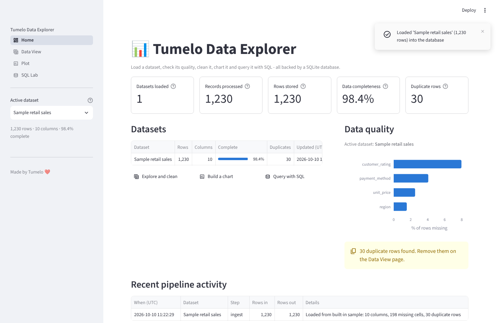
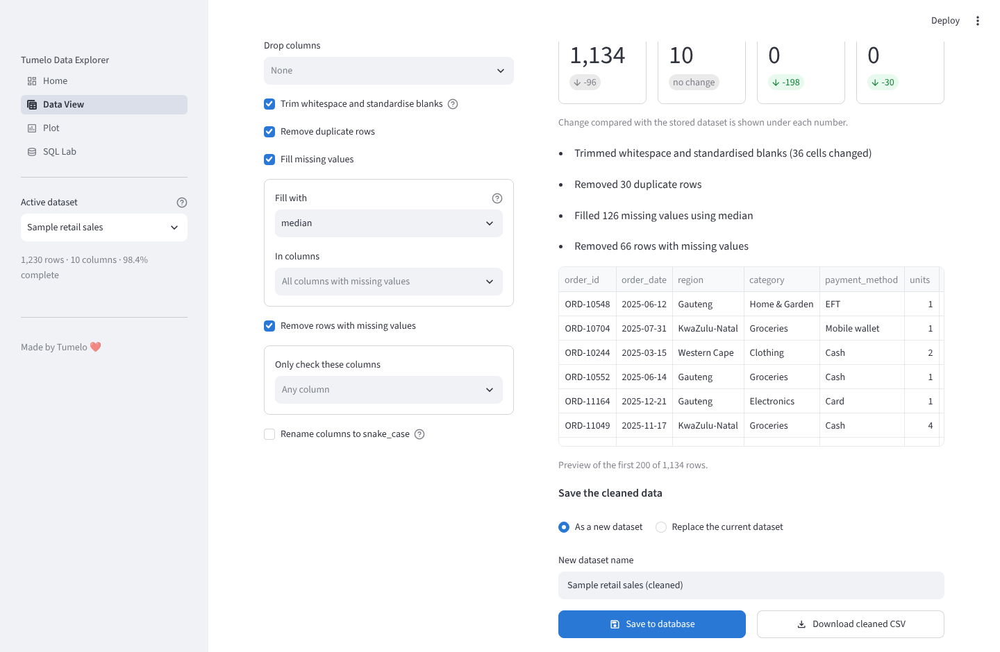
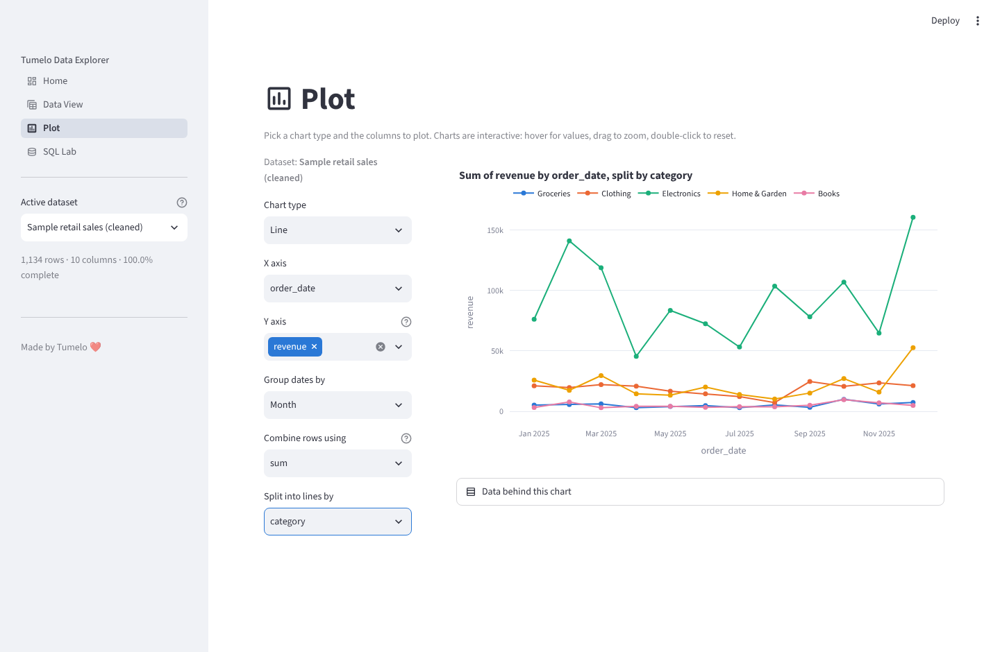
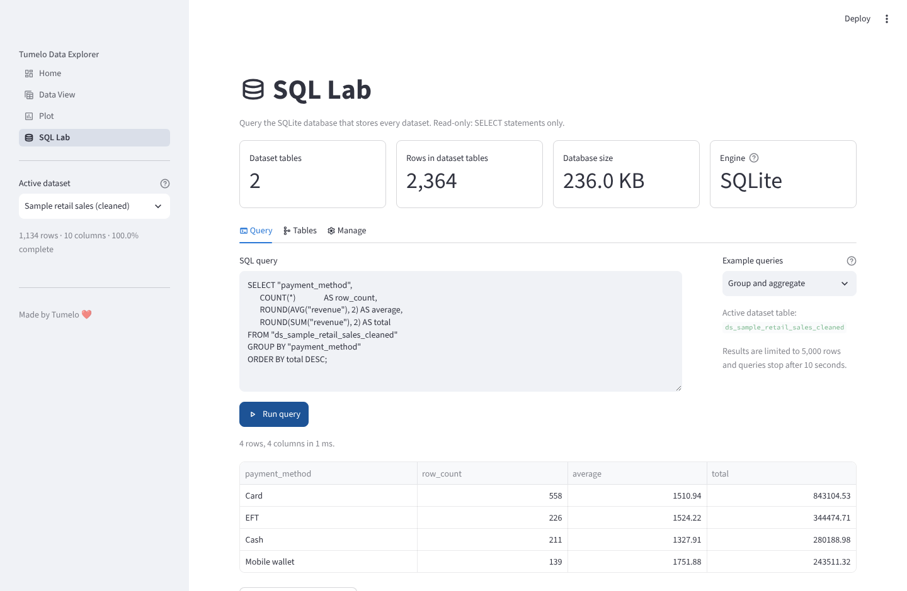

# Tumelo Data Explorer: Streamlit Analytics Dashboard

An interactive data analytics dashboard built with Python, Streamlit and SQLite. Upload a CSV, check its quality, clean it, chart it and query it with SQL.



## Overview

Tumelo Data Explorer was developed as part of my learning journey during the CHPC–NITheCS Coding Summer School 2026, where I worked with Python programming, data pipelines, exploratory data analysis, visualisation, probability and statistics, and machine learning fundamentals.

The project turns a basic Streamlit exercise into a small but complete data application with a real pipeline behind it:

```
Data source  →  Python processing  →  SQLite database  →  Streamlit dashboard
(CSV upload)    (pandas: parse,       (dataset tables,     (KPIs, tables,
                 tidy, profile)        catalog, run log)    charts, SQL)
```

## Features

### Home
- KPI cards: datasets loaded, records processed, rows stored, data completeness and duplicate rows.
- Catalog of every dataset in the database with a completeness bar.
- Data-quality snapshot of the active dataset.
- Log of recent pipeline activity (loads, cleaning runs, deletions).

### Data View
- **Load**: upload a CSV (comma, semicolon or tab separated; delimiter and encoding are detected) or load the built-in sample dataset.
- **Explore**: sortable interactive table with search, per-column filters (ranges, dates, values, text) and a column picker. Download the filtered rows.
- **Data quality**: row and column counts, missing values per column, the actual duplicate rows, column types and numeric summary statistics.
- **Clean**: drop columns, trim whitespace, remove duplicates, fill missing values (mean, median, mode, constant, forward fill), drop incomplete rows and rename columns to snake_case. A before/after preview shows the effect before anything is saved. Save as a new dataset or replace the original.



### Plot
Pick any columns from the active dataset and build:
- Line charts (with day/week/month/quarter/year grouping for dates)
- Bar charts (count, sum, mean, median, min, max; optionally split by a second column)
- Histograms
- Scatter plots
- Box plots
- Correlation heatmaps

Every chart is interactive, and the exact data behind it can be viewed and downloaded.



### SQL Lab
- Write SQL against the SQLite database that stores every dataset.
- Example queries generated for the active dataset's real column names.
- Browse tables and their columns.
- Read-only by design: the connection is opened in SQLite's read-only mode, so `INSERT`, `UPDATE`, `DELETE` and `DROP` are rejected by the database itself.



## Project structure

```
app.py                  Entry point: page config, navigation, shared sidebar
views/                  One file per page - Streamlit code only
    home.py
    data_view.py
    plots.py
    sql_lab.py
ui/
    components.py       Shared widgets: page header, KPI cards, dataset picker
data_explorer/          Data layer - no Streamlit imports anywhere in here
    cleaning.py         Reusable cleaning functions + clean_dataset()
    filtering.py        Row filters as small data objects
    profiling.py        Shape, missing values, duplicates, column types
    charts.py           Plotly figure builders
    database.py         All SQL: dataset tables, catalog, pipeline log, queries
    pipeline.py         source → processing → database, in one call
    sample_data.py      A deliberately messy demo dataset
    config.py           Paths and limits
tests/                  pytest suite for the data layer and every page
docs/CHANGES.md         What changed in version 2 and why
```

The rule that keeps this tidy: **pages collect choices and display results; `data_explorer` does the work.** Because the data layer never imports Streamlit, the same functions run in a notebook, a script or a test:

```python
from data_explorer import database, pipeline
from data_explorer.cleaning import CleaningOptions

record = pipeline.ingest_csv("sales.csv", name="Sales")
cleaned, report = pipeline.clean_and_save(
    record, CleaningOptions(trim_whitespace=True, drop_duplicates=True), new_name="Sales clean"
)
print(report.summary())
print(database.run_query("SELECT COUNT(*) AS n FROM ds_sales_clean").data)
```

## The database

The app creates `data/explorer.db` on first run. It contains:

| Table | Purpose |
|---|---|
| `datasets` | Catalog: one row per dataset with its table name, row and column counts, missing cells, duplicate rows and column types |
| `pipeline_runs` | Append-only log of every ingest, clean and delete, with rows in and rows out |
| `ds_<name>` | One table per dataset holding its rows |

The Home page KPIs are SQL aggregates over `datasets` and `pipeline_runs`.

To store the database somewhere else, set the `DATA_EXPLORER_DB` environment variable to a file path.

## Installation

```bash
git clone https://github.com/callmetumz/Tumelo-Data-Explorer-Streamlit-Analytics-Dashboard.git
cd Tumelo-Data-Explorer-Streamlit-Analytics-Dashboard

python -m venv .venv
source .venv/bin/activate        # Windows: .venv\Scripts\activate
pip install -r requirements.txt
```

## Running the app

```bash
streamlit run app.py
```

or

```bash
python run_streamlit.py
```

Then open http://localhost:8501. Click **Load sample dataset** on the Home page to try everything without a file of your own.

## Running the tests

```bash
pip install -r requirements-dev.txt
pytest
```

The suite covers the cleaning, filtering, profiling, chart, database and pipeline modules, and runs every page headlessly with Streamlit's test client.

## Deployment note

On Streamlit Community Cloud the SQLite file lives on temporary disk: it is shared by everyone using the app and is reset whenever the app restarts. That is fine for a demo. For data that must persist, point the app at a hosted database (see Roadmap).

## Technologies used

- Python
- Streamlit
- pandas and NumPy
- Plotly
- SQLite (Python's built-in `sqlite3`)
- pytest
- GitHub

## Skills demonstrated

- Python programming and project organisation into modules
- Separating data processing from presentation code
- Data loading, profiling and cleaning with pandas
- Database design, storage and retrieval with SQL
- Building an end-to-end data pipeline
- Interactive data visualisation
- Automated testing
- Streamlit application development and UI design
- GitHub project documentation

## Roadmap

Ideas that are not built yet:

- Machine learning demo: simple regression on chosen numeric columns with evaluation metrics.
- Excel and Parquet uploads.
- A hosted database (PostgreSQL) so data persists on Streamlit Community Cloud.
- Undo for cleaning runs by keeping dataset versions.
- An About page.

## Changes

See [docs/CHANGES.md](docs/CHANGES.md) for what changed in version 2 and why.
